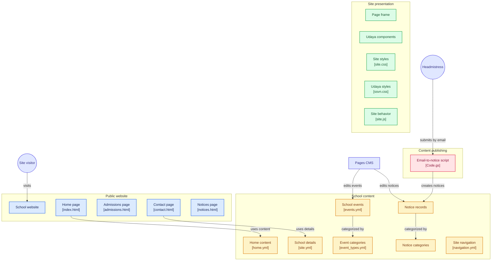

# Email → website notice, and Google Calendar → school calendar (setup and upkeep)

The headmistress posts a notice by emailing **ssvn.em.high.school+notice@gmail.com** from **ssvn.em.high.school@gmail.com**. A Google Apps Script running in that Gmail account turns the email into a notice file in this repository; GitHub Pages republishes the site about a minute later. Her instructions: [docs/how-to-post-a-notice.md](../../docs/how-to-post-a-notice.md).

```
Gmail (Sent folder) ──every 5 min──► Code.gs ──GitHub API, one commit──► _notices/*.md (+ assets/notices/*) ──► GitHub Pages
        ▲                                │
        └──── "Published: …" reply ──────┘
```

The same script keeps the website's school calendar in step with the school's **Google Calendar** ("Sri Sai Vidyanikethan E.M. High School Events"). Whenever an event there is added, changed or deleted, it rewrites `_data/events.yml`, which feeds the home page's "Coming up" list and the Notices page's calendar. See [How events are read from Google Calendar](#how-events-are-read-from-google-calendar).

```
Google Calendar (event changed) ──► Code.gs: syncCalendar ──GitHub API, one commit (only if different)──► _data/events.yml ──► GitHub Pages
```

| File | What it is |
| --- | --- |
| `Code.gs` | The script. Paste it into the Apps Script project. |
| `appsscript.json` | The project manifest: time zone, Gmail advanced service, permissions. |
| `test.js` | Tests with stand-ins for Gmail, Google Calendar and GitHub: `node --test tools/email-to-notice/test.js` |

**Safety.** Only email the account *sent* counts (Gmail's Sent label). Anyone can write to the `+notice` address, but nobody else can put mail in the account's Sent folder, so forged emails, including forged replies threaded into a real notice, are ignored. Notice text is published as plain text (no HTML, no Jekyll template code), and titles are escaped on the page. The GitHub token can only change the contents of this one repository.

## One-time setup (about 15 minutes)

You need: the Google login for ssvn.em.high.school@gmail.com, and a GitHub account with write access to this repository.

### 1. Create the GitHub token

1. On GitHub: **Settings → Developer settings → Personal access tokens → Fine-grained tokens → Generate new token**.
2. Name: `Website notices (email)`. Expiration: the longest allowed (usually 366 days). Write the date down.
3. Resource owner: **Sri-Sai-Vidyanikethan-EM-High-School**. Repository access: **Only select repositories** → `srisaividyanikethan.edu.in`.
4. Repository permissions: **Contents → Read and write**. Leave everything else as "No access".
5. Generate, and copy the token (it is shown once).

If the organisation requires approval for fine-grained tokens, an organisation owner approves it under **Organisation settings → Personal access tokens → Pending requests**.

### 2. Create the Apps Script project

1. Signed in as **ssvn.em.high.school@gmail.com**, open https://script.google.com and choose **New project**. Name it `Website notices`.
2. **Project settings** (gear icon) → tick **Show "appsscript.json" manifest file in editor**.
3. In the editor, replace the contents of `Code.gs` with this folder's `Code.gs`, and `appsscript.json` with this folder's `appsscript.json`. Save.
4. **Project settings → Script properties → Add script property**:

   | Property | Value |
   | --- | --- |
   | `GITHUB_TOKEN` | the token from step 1 |
   | `TOKEN_EXPIRES` | its expiry date, e.g. `2027-10-15` |
   | `GITHUB_BRANCH` | only while testing before launch: `redesign` (default `main`) |

   Optional, with their defaults: `GITHUB_REPO` (`Sri-Sai-Vidyanikethan-EM-High-School/srisaividyanikethan.edu.in`), `NOTICE_ADDRESS` (`ssvn.em.high.school+notice@gmail.com`), `SITE_URL` (`https://srisaividyanikethan.edu.in`), `CALENDAR_ID` (the school events calendar, `d3c7c1b0…@group.calendar.google.com`).

### 3. Give the script the school calendar

The script reads the calendar as **ssvn.em.high.school@gmail.com**, so that account must **own** the calendar or be **subscribed** to it.

- If the school account created the calendar, there's nothing to do.
- Otherwise, signed in as the school account, open the calendar's link and choose **Add**: https://calendar.google.com/calendar/u/0?cid=ZDNjN2MxYjA0NWQ1ZTM1NDljMmQ5MjJlYTUxZjdlZjZmZWU3YjEyMmFjODE1MGFmMTBkZWE5MzdiZDA3YWNmMUBncm91cC5jYWxlbmRhci5nb29nbGUuY29t
- If the calendar ever stops being public, share it with the school account instead (**Settings and sharing → Share with specific people → See all event details**).

### 4. Run setup

1. In the editor, choose the function **setup** and press **Run**.
2. Google asks for permission (read and send Gmail, see your calendars, connect to GitHub, run on a schedule). Choose the school account → **Advanced → Go to Website notices (unsafe)** → **Allow**. The warning appears because this is a private script, not a published app.
3. The log should say *"GitHub token works…"*, *"Triggers created…"* and *"Calendar sync set up…"*. If it says otherwise, the message names the setting to fix. If it says the calendar can't be opened, do step 3 and run **setup** again.

### 5. Test it

1. From the school Gmail, send an email to `ssvn.em.high.school+notice@gmail.com` with the subject `[Event] Test notice — please ignore` and one line of text.
2. Within about 5 minutes, a reply arrives in the same thread: *"Published: …"* with the link. The commit appears in the repository.
3. Reply to that email with just `remove`. A *"Taken down"* reply follows, and the notice disappears.

4. In Google Calendar, add an all-day event to the school calendar, e.g. `[Event] Test event — please ignore`. Within about 2 minutes, a commit *"Update the school calendar from Google Calendar"* appears and the event shows on the Notices page. Delete the event, and it's removed the same way.

While the redesign isn't live yet (`GITHUB_BRANCH` = `redesign`), notices and events appear in the branch and in a local preview, not on the live site. **At launch, delete the `GITHUB_BRANCH` property** so they go to `main`.

## Upkeep

### Renew the GitHub token (once a year)

The script emails the account 30 days before `TOKEN_EXPIRES`, and immediately if GitHub rejects the token.

1. On GitHub, open the token (**Settings → Developer settings → Fine-grained tokens**) and choose **Regenerate token**, or create a new one as in step 1.
2. In the Apps Script project, **Project settings → Script properties**: paste the new value into `GITHUB_TOKEN` and update `TOKEN_EXPIRES`.

Notices emailed while the token wasn't working are published on the next run (within 5 minutes).

### Update the script

Change `Code.gs` in this repository, run the tests, commit, then paste the new `Code.gs` into the Apps Script editor and save. Triggers keep working; there's no need to run `setup` again, unless `appsscript.json` changed (new permissions or triggers): then paste it too and run **setup** once more.

### When something goes wrong

- **No reply after 10 minutes:** in the Apps Script project, open **Executions** to see each run and any error. Check that the email was sent *from* the school account *to* the `+notice` address.
- **A notice failed three times:** the reply says so and shows the error. Usually GitHub was down; sending the email again is enough.
- **Fix a notice without email:** edit or delete it in Pages CMS, or edit its file in `_notices/` on github.com. The script only touches notices that arrived by email, and only when a new email arrives in that notice's thread.
- **An event doesn't appear:** check it is on the school calendar (not a personal one) and inside the window (1 June of this academic year to the end of the next). **Executions** shows each `syncCalendar` run. Running `syncCalendar` by hand forces an update.
- **Edited `_data/events.yml` by hand?** The next calendar change overwrites it. Make changes in Google Calendar.
- **Stop the script:** in **Triggers**, delete all the triggers. Run `setup` again to restart.

## How events are read from Google Calendar

| In Google Calendar | On the website |
| --- | --- |
| Event title | The event's title, without any `[tag]` |
| `[Holiday]`, `[Exam]`, `[Event]` or `[Meeting]` in the title | The event type. A tag wins over the colour. |
| Event colour (when there's no tag): **Banana** (yellow) = Holiday, **Sage** or **Basil** (green) = Exam, **Tangerine** (orange) = Event, **Graphite** (grey) = Meeting | The event type. Any other colour, or none, = Event. |
| All-day event over several days | A date range, e.g. "19 – 24 October" |
| Event with a time | The start time in the note, e.g. "9:30 am" |
| First line of the description | The note, e.g. "school reopens 26 October" (plain text, up to 80 characters) |
| Repeating events | Each occurrence |

The script reads events from **1 June of the current academic year to the end of the next one**; the daily run moves the window forward. Past events fade on the Notices page and drop off the home page by themselves. `_data/events.yml` is rewritten only when the result differs, so unchanged calendars make no commits.

## What the script writes

`_notices/2026-10-14-school-closed-on-20-october.md`, with the same fields Pages CMS edits (see `.pages.yml` and [docs/pages-cms.md](../../docs/pages-cms.md)):

```markdown
---
title: "School closed on 20 October"
title_te: "విజయదశమి సెలవు"
date: 2026-10-14 09:30
category: Holiday
urgent: true
expires: 2026-10-21
attachments:
  - "/assets/notices/2026-10-14-school-closed-on-20-october-holiday-circular.pdf"
source: email
---
School will be closed on Tuesday 20 October for Vijayadashami.
```

The email text is written with `<`, `>`, `&`, `{` and `}` as HTML character codes, so nothing in an email can become HTML or Jekyll template code; they display as normal characters on the page and in Pages CMS.


